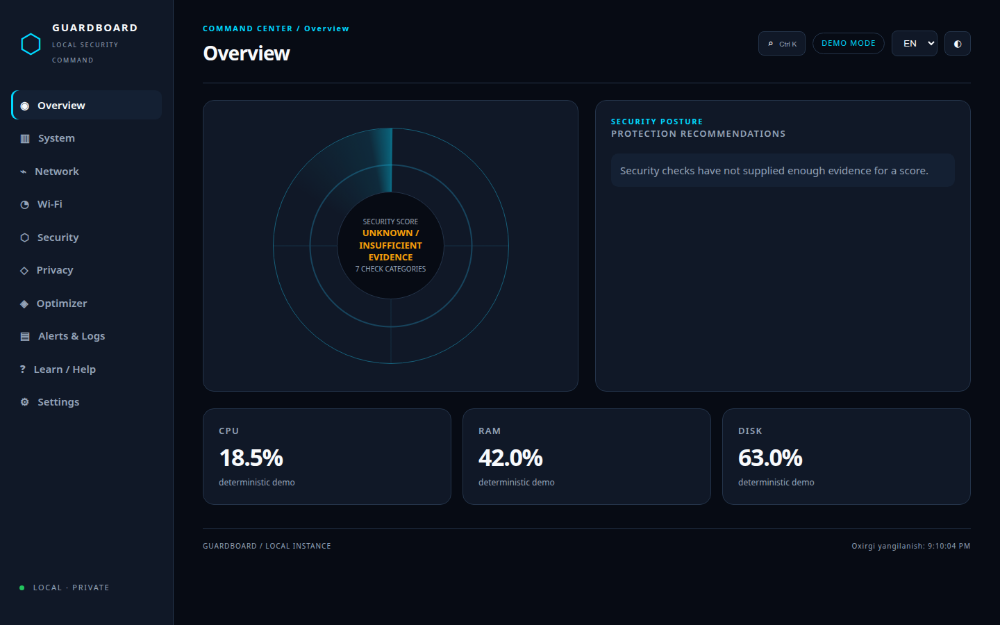
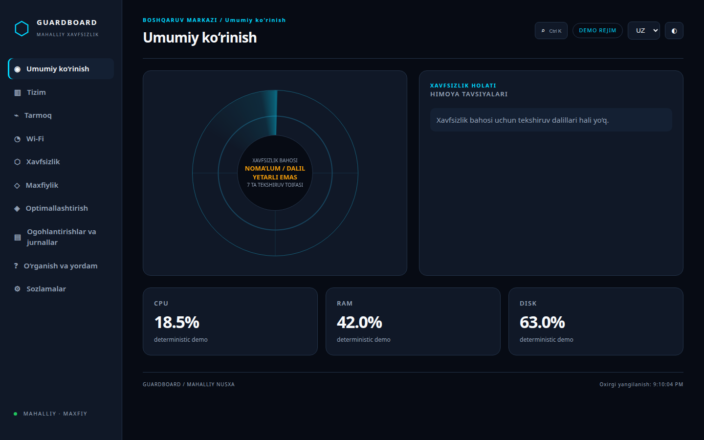
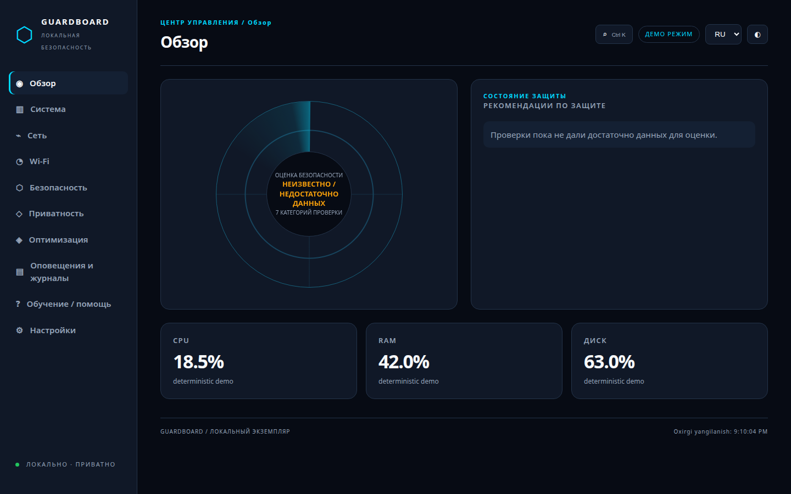
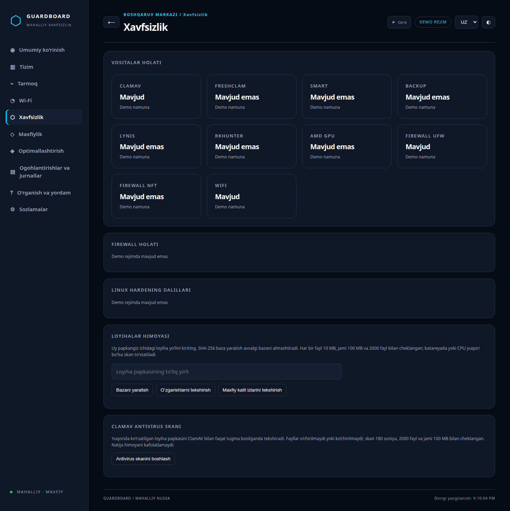
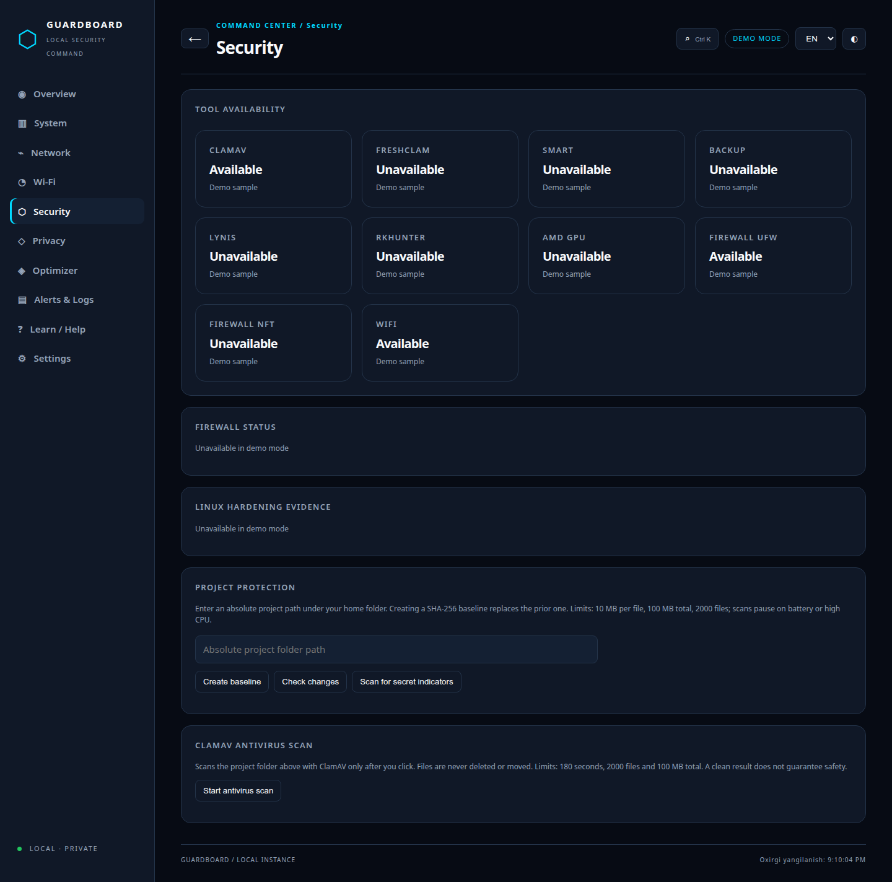
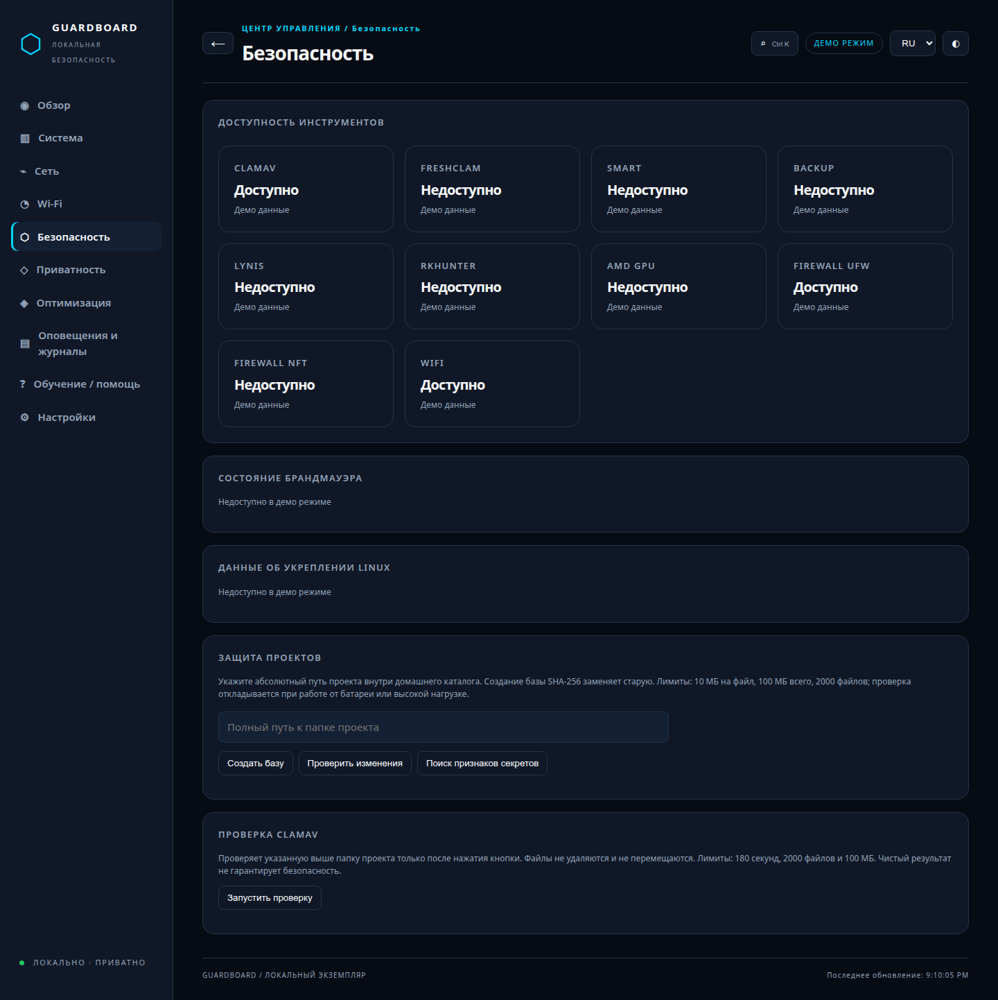
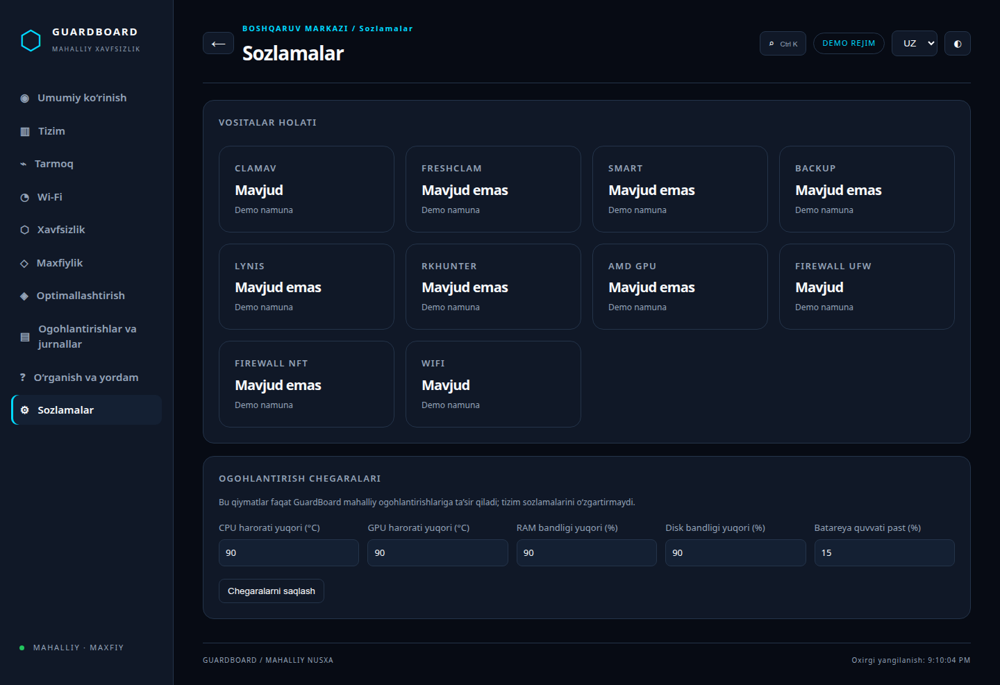
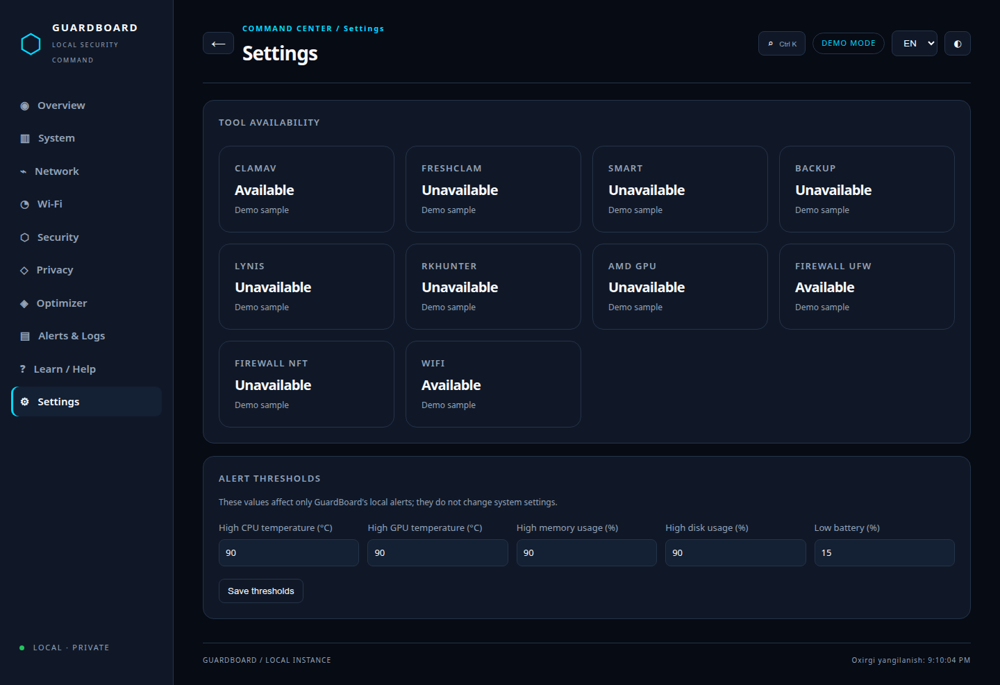
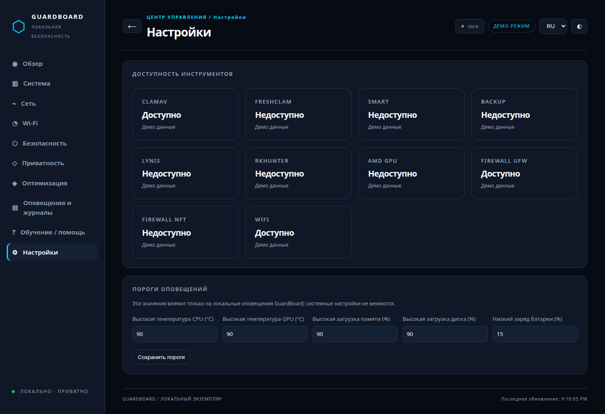

# GuardBoard

[](https://github.com/shomatoff/GuardBoard/actions/workflows/ci.yml)

**EN:** A local-first Linux security and monitoring command center. GuardBoard combines live hardware telemetry, network and Wi-Fi diagnostics, defensive checks, project integrity monitoring, alerts and a transparent security radar in one localhost application.

**UZ:** Linux uchun mahalliy xavfsizlik va monitoring markazi. GuardBoard real apparat telemetriyasi, tarmoq va Wi-Fi diagnostikasi, himoya tekshiruvlari, loyiha yaxlitligi, ogohlantirishlar va shaffof xavfsizlik radarini bitta localhost ilovasida birlashtiradi.

**RU:** Локальный центр безопасности и мониторинга Linux. GuardBoard объединяет телеметрию оборудования, диагностику сети и Wi-Fi, защитные проверки, контроль целостности проектов, оповещения и прозрачный радар безопасности в одном приложении localhost.

Languages / Tillar / Языки: **English** · [O‘zbekcha](docs/README.uz.md) · [Русский](docs/README.ru.md)

**Ultimate Linux Security, Privacy, Network & Performance Command Center.** GuardBoard is a local-first Linux monitoring and defensive security application. This repository is under active development. The current build has a localhost-only FastAPI server, ten navigable sections, Uzbek/English/Russian labels, themes, live hardware and network telemetry, Wi-Fi diagnostics, and selected project protection. The radar deliberately displays insufficient evidence until all defensive categories can be assessed.



## Download / Yuklab olish / Скачать

Development preview archive: [GuardBoard v0.1.0-dev.1](https://github.com/shomatoff/GuardBoard/releases/tag/v0.1.0-dev.1). Download `GuardBoard-Linux-x64.tar.gz` and `SHA256SUMS` from that release, then run:

```bash
sha256sum -c SHA256SUMS
tar -xzf GuardBoard-Linux-x64.tar.gz
./GuardBoard/GuardBoard
```

The archive bundles Python dependencies and the local frontend for Linux x64. It is unsigned and initially validated on Ubuntu 24.04. The first run creates private application data under `~/.local/share/guardboard`. Keep the terminal open and open the printed localhost URL in your browser. Run `./GuardBoard/GuardBoard --demo` for labeled sample data. This is a development preview, not a production security tool.

Mos Linux x64 paketini **Releases** bo‘limidan oling. `SHA256SUMS` bilan tekshiring, arxivni oching va `./GuardBoard/GuardBoard` ni ishga tushiring. Demo uchun `./GuardBoard/GuardBoard --demo` buyrug‘idan foydalaning.

Скачайте пакет Linux x64 из раздела **Releases**, проверьте его через `SHA256SUMS`, распакуйте архив и запустите `./GuardBoard/GuardBoard`. Для демонстрационных данных используйте `./GuardBoard/GuardBoard --demo`.

## Languages / Tillar / Языки

Select **English**, **O‘zbekcha**, or **Русский** in Settings. The navigation, radar labels, security findings, help content and empty/error states use the selected language. Demo screenshots below show the same application in all three languages.

Sozlamalar sahifasida **English**, **O‘zbekcha** yoki **Русский** tilini tanlang. Menyu, radar, xavfsizlik topilmalari, yordam matnlari va holat xabarlari tanlangan tilda ko‘rsatiladi.

В настройках выберите **English**, **O‘zbekcha** или **Русский**. Меню, радар, результаты проверок и справочные материалы отображаются на выбранном языке.

## Features

- Premium security-radar overview with a transparent score and insufficient-evidence state.
- Real Linux CPU, memory, disk, battery, network and supported GPU telemetry.
- Network interfaces, connections, listening ports and opt-in diagnostics.
- Wi-Fi adapter information, signal evidence and nearby-network diagnostics where tools are available.
- Defensive security checks, ClamAV integration, project integrity monitoring and local secret indicators.
- Alerts, local history, Learn content, themes and responsive desktop/mobile layouts.
- Local-only FastAPI/WebSocket service with session authentication, Host/Origin checks and CSRF protection.

Every unavailable sensor is shown as **Not available**. Real mode never substitutes demo values.

### Run from source

Requires Python 3.11+.

```bash
python3 -m venv .venv
.venv/bin/pip install -r requirements.txt
./run.sh
```

Open the exact local URL printed in the terminal. Each server run generates a new random access key. The web server binds only to `127.0.0.1:8765`; do not run it as root. For the clearly labeled deterministic demo, run `./run.sh --demo`. Real mode reads local sensors and does not use example data. `./install.sh` can review Debian/Ubuntu required and optional packages; it asks for selected packages and an exact `YES` before installation. GuardBoard never runs the installer automatically.

## Development

```bash
.venv/bin/pip install -r requirements-dev.txt
.venv/bin/python -m pytest -q
node --check frontend/js/app.js
```

The [release CI run](https://github.com/shomatoff/GuardBoard/actions/runs/38430099389) passed 53 automated tests on each of Ubuntu 22.04 and 24.04, built the Linux archive, checked its SHA256, and smoke-tested demo and real package startup. The published archive was downloaded, checked again, and smoke-tested locally. Chrome may be unavailable elsewhere; the browser test then skips. Tests do not perform privileged system changes or external diagnostics.

## Security and privacy

No system settings are changed by the current build. The server rejects root startup and uses a random in-memory access key, HttpOnly SameSite session cookie, Host and Origin validation, and CSRF checks for mutations. WebSocket access checks the same session and Origin. Local storage uses private directory/file permissions. External network diagnostics run only after a direct user action and confirmation. Project integrity, secret-indicator checks and ClamAV scans are local and explicitly triggered. Secret findings contain file paths, line numbers and categories; matched values are not returned. A full security audit and privileged action framework remain unfinished.

## Availability

Ubuntu 24.04 on AMD hardware has been smoke tested. Other distributions and sensor combinations need tests. UFW/nftables status needs elevated read access on the tested host, so the interface displays unknown. SMART health also needs privilege. ClamAV signatures are installed, but a real project scan has not been executed during development. The Privacy page reads local DNS and NetworkManager VPN connections; it does not run a DNS leak test or manage VPN connections. Alerts currently cover measured temperature, memory, disk and battery thresholds; Settings can change their limits in local TOML. Learn contains 14 topics in three languages. Optimizer currently reads power state and shows proposals; applying profiles, full alerting, full settings and backup remain unfinished; see [PLAN.md](PLAN.md). Missing sensor readings remain unavailable.

## Screenshots / Skrinshotlar / Скриншоты

| Actual demo screen | Uzbek | English | Russian |
|---|---|---|---|
| Overview |  |  |  |
| Security |  |  |  |
| Settings |  |  |  |

[Demo Learn page](docs/screenshots/demo-learn.png) · [Mobile Settings](docs/screenshots/demo-settings-mobile.png)

Screenshots are local captures from the running application in demo mode, not design mockups. Real monitoring screenshots are excluded to protect host information. [Open the full-size images](docs/screenshots/).

## Verification status

The packaged Linux application was started in demo mode from the published release and returned its authenticated localhost URL. The release archive passed `sha256sum -c SHA256SUMS`; CI verified both Ubuntu 22.04 and 24.04, 53 tests per environment, package startup in demo and real modes, and checksum creation. The application remains a development preview while privileged actions, applied optimizer profiles, VPN control and several advanced security workflows are unfinished.

## Feature availability

| Feature | Current state | Dependencies or limits |
|---|---|---|
| Hardware telemetry | Working where Linux exposes sensors | `psutil`, sysfs, accessible sensor data |
| AMD GPU usage/VRAM/power | Working where sysfs exposes values | Other vendors are recognized; detailed readings remain partial |
| SMART health | Unavailable on tested unprivileged account | `smartctl` needs elevated read access |
| Network/Wi-Fi | Read-only monitoring works | `nmcli`/`iw` for Wi-Fi evidence; some PIDs need privilege |
| ClamAV scan | On-demand job API/UI implemented | `clamscan` and local signatures; real scan has not been verified |
| Firewall and hardening evidence | Partial read-only checks | UFW/nftables need elevated read access; missing tools stay unavailable |
| Project integrity/secret indicators | Working for selected home-directory projects | Bounded traversal; heuristics can be wrong |
| Privacy status | Local DNS and NetworkManager VPN evidence | No confirmed DNS leak test or VPN control |
| Alerts | Measured temperature/memory/disk/battery events | Other categories and desktop notifications pending |
| Optimizer | Read-only current state and proposals | No benchmark or applied profile yet |
| Privileged actions and backup | Not implemented | Audited helper and safe restore flow required |

## Architecture and threat model

The frontend uses HTML, CSS and vanilla ES modules with local assets, no CDN, no analytics and no mandatory build step. FastAPI exposes authenticated JSON and WebSocket endpoints. Read-only collectors fail independently; a missing sensor stays unavailable. SQLite stores local history, alerts and selected project data. Alert thresholds use validated local TOML. See [architecture](docs/architecture/README.md), [scoring](docs/architecture/scoring.md) and [safe operation policy](docs/safety/operations.md).

The main threat boundaries are unauthorized localhost access, cross-origin requests, unsafe paths, unbounded file/process work and accidental system changes. Current controls are documented in [SECURITY.md](SECURITY.md). This build has **not** completed a full security audit and should not be described as production ready.

## Known limits and troubleshooting

- `Not available` means data was not observed; it is not a healthy value. Check sensor access and optional tools before relying on a reading.
- UFW/nftables and SMART can need privileged read access. GuardBoard does not elevate itself.
- A local DNS server address is not evidence of a DNS leak. A real leak test needs an explicit external request.
- RSSI is approximate signal strength, not physical distance. A new local device is an indicator, not proof of an attacker.
- ClamAV and secret scanning can miss threats or produce false positives. A clean scan is not a guarantee.
- If startup reports a missing environment, recreate `.venv` and install `requirements.txt`. If port 8765 is occupied, stop the other local instance before launching another one.
- Optimizer, full hardening and backup workflows remain incomplete. See [PLAN.md](PLAN.md).

## Contributing, roadmap and license

Read [CONTRIBUTING.md](CONTRIBUTING.md) before contributing. [PLAN.md](PLAN.md) is the live roadmap and milestone verification record. The code is licensed under [MIT](LICENSE). Keep personal telemetry, device inventories, secret values and local databases out of commits and screenshots.
